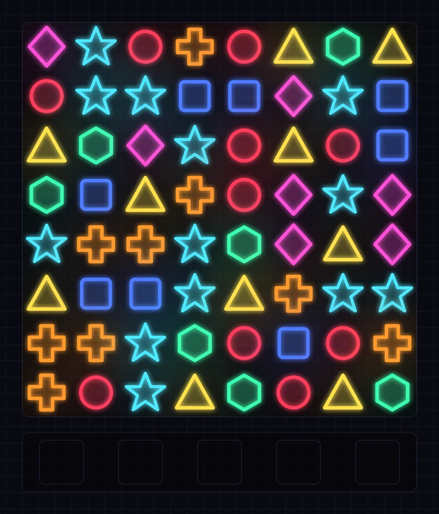
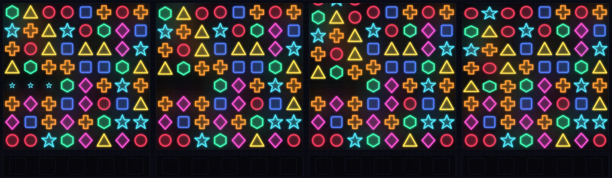
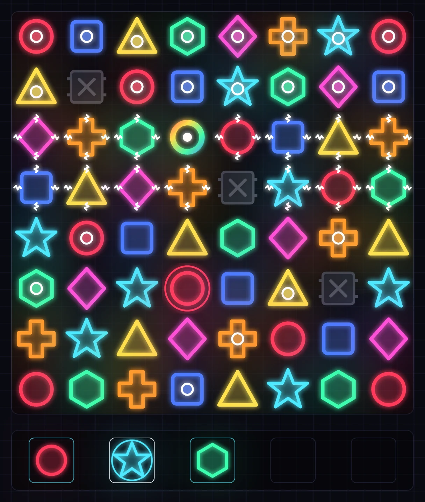

# Voltline

A neon match-three puzzle game with explosive special pieces, chain reactions, a collectable tray, and an AI that plays like a strong human. Swap pieces, line up three or more, and watch the board light up.

**Play it:** https://voltline.mrballistic.com

Voltline is an original game. It has its own pieces, its own look and its own sounds; it borrows only the genre’s mechanics.

## How to play

The board is 8×8. Swap two neighboring pieces; if the swap lines up three or more of the same color in a row or column, they clear. Pieces above the gap fall, new ones drop in, and any new matches clear too. Each link in that chain scores more than the last.

A swap that makes no match slides back, so you can’t waste a move on one.

### The pieces

Seven colors, each with its own shape so the game is playable without relying on color: red circle, blue rounded square, yellow triangle, green hexagon, magenta diamond, orange plus and cyan star.

### Special pieces

Bigger matches leave something behind.

| Make this | Get this | What it does |
|---|---|---|
| 4 in a line | **Charge** | Clears the 3×3 area around it |
| An L or T shape | **Arc** | Clears its whole row and column |
| 5 in a line | **Prism** | Swap it with any piece to clear every piece of that color |

Specials chain. An explosion that catches another special sets it off, so one good match can clear half the board. Two Prisms swapped together clear everything. A Prism swapped with a Charge or Arc turns every piece of that color into one and detonates the lot.

### The tray

Every 10 pieces of one color you clear, by any means, earns a spare piece of that color in your tray. The tray holds five. To spend one, tap it, then tap a plain piece on the board: the tray piece takes its place, and if that makes a match it resolves like any swap. Placing costs a move, and you may place without making a match, though that piece is gone for good. Earn a piece while the tray is full and it is lost, so spend one.

### Rocks

From level 10, burnt-out gray rocks start appearing among the new pieces. They fall and swap like anything else, but they only clear when you match three of them or an explosion reaches them. A Prism can’t be swapped with a rock. The deeper you go, the more often they show up.

### Levels and game over

A progress bar fills as you score. Fill it to level up: the board is replaced with a fresh one, the target rises, and your tray carries over.

The game ends when no move on the board can make a match, and that includes tray placements. That’s the tray’s promise: the tray can save you, as long as a spare piece can still make a match when nothing else can.

## Modes

- **Player.** You play. Your best score is saved in your browser.
- **AI mode.** Watch the computer play, at slow, medium or fast speed, with pause and a move counter. It keeps its own best score, so it never takes your record.
- **Hint.** Shows the moves the AI found as faint arrows, each with a value, then fades the weaker ones until the best is left.

The AI is a search, not a chatbot. It looks at exactly what you can see (the board, the tray and the level), tries each move many times over with randomly dropped-in new pieces, and picks the one that does best on average. It never peeks at what the game will drop next, and it needs no network or API key.

## Controls

Click or tap a piece, then a neighbor, to swap. Or just drag (or swipe) a piece toward a neighbor: the swap happens as soon as you pull past a third of a cell. Tap a tray piece, then a board piece, to place it, or drag it straight onto the board. A drag that goes nowhere eases back.

## Credits and license

Sound effects come from other creators under their own licenses; see [CREDITS.md](./CREDITS.md). Voltline itself is MIT licensed; see [LICENSE](./LICENSE).

For developers, see [ARCHITECTURE.md](./ARCHITECTURE.md).
